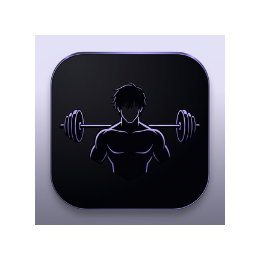
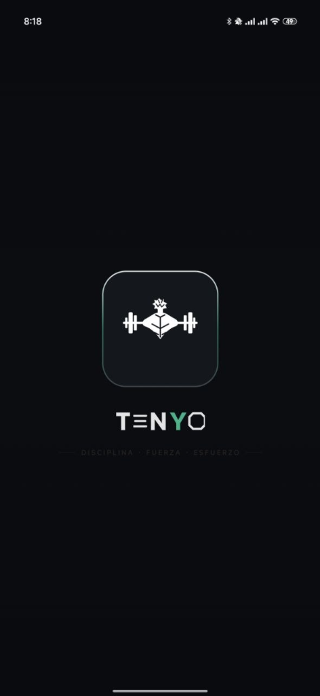
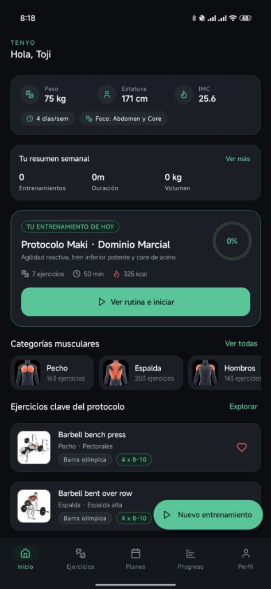
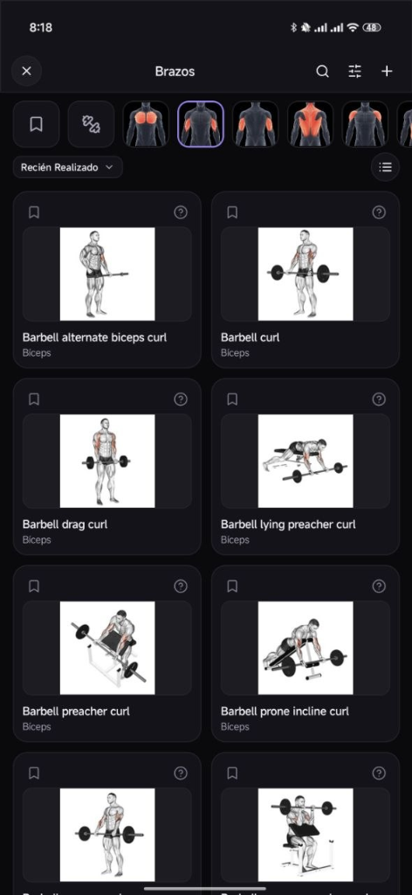
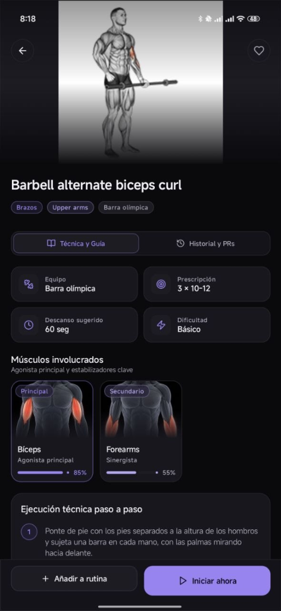
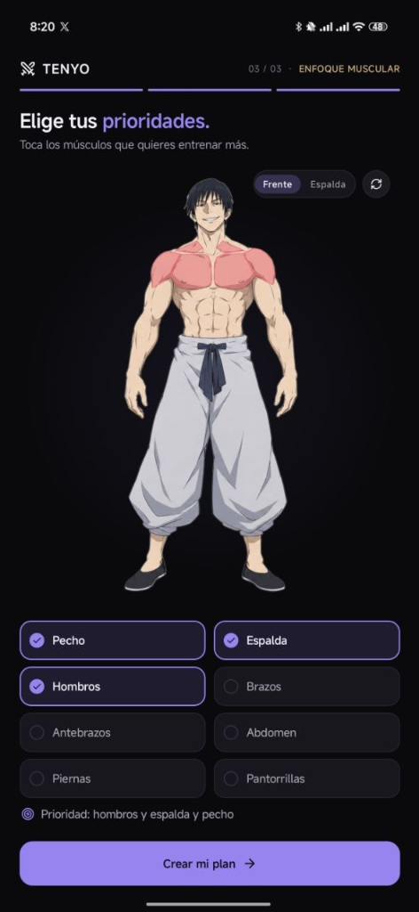
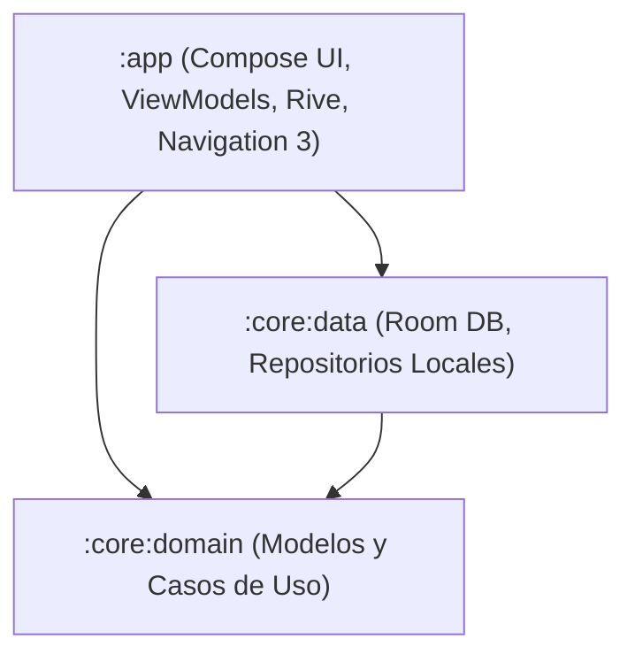

<div align=center>

# Tenyo (天与)

</div>

<div align="center">



### *Tu compañero de entrenamiento: paso a paso en el gym o en casa*

[](https://kotlinlang.org/)
[](https://developer.android.com/)
[](https://developer.android.com/jetpack/compose)
[](https://developer.android.com/guide/navigation)
[](https://rive.app/)
[](https://developer.android.com/training/data-storage/room)
[](https://insert-koin.io/)

</div>

---

## 💡 ¿Qué es Tenyo?

**Tenyo** es una aplicación diseñada para acompañarte en tus entrenamientos diarios, ya sea que estés dando tus **primeros pasos en el gimnasio** o busques ponerte en forma **haciendo ejercicios desde casa**.

Muchas veces empezar a entrenar resulta abrumador: no sabemos qué ejercicios hacer, cómo realizarlos correctamente o qué músculos estamos trabajando. Tenyo soluciona esto de manera visual, sencilla y motivadora:

- **Instrucciones claras paso a paso:** Aprende la técnica correcta de cada movimiento para entrenar con seguridad y evitar lesiones.
- **Enfoque práctico y visual:** Gracias a su **mapa corporal interactivo** (con los arquetipos de Toji y Maki impulsados por animaciones de Rive), solo necesitas tocar la parte del cuerpo que quieres ejercitar (pecho, espalda, brazos, piernas o abdomen) para ver de inmediato los ejercicios ideales.
- **Sin complicaciones ni cuentas obligatorias:** Funciona **100% offline**, directo en tu teléfono y sin depender de internet o señal en el gimnasio.

---

## 📱 Capturas de Pantalla

<div align="center">

| 1. Bienvenida | 2. Inicio y Rutina del Día | 3. Catálogo por Músculo |
| :---: | :---: | :---: |
|  |  |  |

| 4. Guía Técnica Paso a Paso | 5. Mapa Corporal Interactivo |
| :---: | :---: |
|  |  |

</div>

---

## 🌟 Funcionalidades Destacadas

### 🏋️ 1. Guías Técnicas y Músculos Involucrados
- **Explicación clara de la ejecución:** Instrucciones enumeradas paso a paso sobre cómo posicionar el cuerpo, sujetar la carga y realizar el movimiento.
- **Anatomía al instante:** Muestra qué músculo es el **principal (agonista)** y cuáles actúan como **secundarios (sinergistas/estabilizadores)** con porcentajes visuales.
- **Recomendaciones útiles:** Series sugeridas, repeticiones recomendadas, equipo necesario (mancuernas, barra, máquinas o peso corporal) y temporizador de descanso entre series.

### 🎯 2. Selector Corporal Interactivo con Rive
- **Toca y entrena:** Un mapa anatómico en tiempo real donde puedes alternar entre vista **Frente** y **Espalda**.
- **Modelos de Toji y Maki:** Animaciones fluidas desarrolladas con el runtime de **Rive 2D**, que iluminan exactamente las zonas musculares seleccionadas.

### 📋 3. Rutinas Adaptadas (Gym o Casa)
- **Planes predefinidos:** Protocolos enfocados en fuerza, agilidad o desarrollo muscular integral.
- **Libertad total:** Opción de iniciar un nuevo entrenamiento rápido en cualquier momento o seleccionar ejercicios específicos según el equipo disponible.

### 📊 4. Tu Progreso Semanal a la Mano
- **Resumen fácil de leer:** Consulta cuántos entrenamientos has realizado en la semana, el tiempo total invertido y los kilogramos de volumen acumulado.
- **Métricas personales:** Control de peso corporal, estatura y cálculo automático del Índice de Masa Corporal (IMC).

### 🔒 5. Privacidad y Funcionamiento 100% Offline
- Tus datos, rutinas y marcas personales se guardan localmente en tu teléfono con **Room Database**.
- No requiere registros engorrosos ni conexión a internet: abres la app y comienzas a entrenar al instante.

---

## 🛠️ Arquitectura y Tecnologías

Para desarrolladores y entusiastas del código abierto, el proyecto está construido bajo los estándares más modernos del ecosistema Android:



- **Lenguaje:** [Kotlin 2.0+](https://kotlinlang.org/) con corrutinas y Flow reactivo.
- **Interfaz de Usuario:** [Jetpack Compose](https://developer.android.com/jetpack/compose) con Material 3 Dark Theme (estética minimalista Obsidian & Emerald).
- **Animaciones Interactivas:** [Rive Android](https://rive.app/) con enlace a State Machines y ViewModels reactivos (`BodyMapVM`).
- **Navegación:** [Jetpack Navigation 3](https://developer.android.com/guide/navigation) con serialización tipo-seguro.
- **Inyección de Dependencias:** [Koin](https://insert-koin.io/) para Compose y ViewModels.
- **Base de Datos:** [Room Database](https://developer.android.com/training/data-storage/room) con persistencia offline-first.
- **Carga de Imágenes:** [Coil 3](https://coil-kt.github.io/coil/) para ilustraciones anatómicas y GIFs explicativos.
- **Iconos:** [Lucide Icons](https://lucide.dev/) adaptados a Kotlin Multiplatform.

---

## 📂 Organización de Módulos

```
tenyo_app/
├── app/                                 # Módulo de interfaz gráfica y experiencia de usuario
│   ├── src/main/java/com/aescalantedev/tenyo/
│   │   ├── ui/
│   │   │   ├── components/              # Botones, tarjetas y chips reutilizables
│   │   │   ├── navigation/              # Configuración de Navigation 3
│   │   │   ├── screens/
│   │   │   │   ├── home/                # Panel de inicio y métricas semanales
│   │   │   │   ├── exercises/           # Lista y detalle técnico de ejercicios
│   │   │   │   ├── categories/          # Exploración por grupo muscular y equipo
│   │   │   │   ├── plans/               # Creación y consulta de rutinas
│   │   │   │   ├── welcome/             # Selector corporal interactivo de Rive
│   │   │   │   └── profile/             # Perfil atlético y ajustes
│   │   │   └── theme/                   # Paleta de colores, tipografía y estilos
│   ├── src/main/res/raw/                # Archivos interactivos de Rive (.riv)
├── core/
│   ├── domain/                          # Entidades puras y lógica de negocio
│   └── data/                            # Base de datos local (Room) y DAOs
└── docs/screenshots/                    # Capturas e iconos para documentación
```

---

## 🚀 Cómo Ejecutar el Proyecto

### Requisitos
1. **Android Studio** Ladybug (2024.2.1) o superior.
2. **JDK 17** configurado en el entorno.
3. Dispositivo o emulador con **Android 8.0 (API 27)** o superior (recomendado Android 14+ / API 34+).

### Pasos
1. Clona el repositorio:
   ```bash
   git clone https://github.com/aescalantedev/tenyo_app.git
   cd tenyo_app
   ```
2. Abre la carpeta del proyecto en Android Studio.
3. Espera a que Gradle termine de sincronizar las dependencias.
4. Conecta tu teléfono o inicia un emulador y haz clic en **Run** (`Shift + F10`) o compila vía terminal:
   ```bash
   ./gradlew assembleDebug
   ```

---

## 🎨 Diseño y Experiencia de Usuario

- **Modo Oscuro Natural:** Colores profundos que facilitan la lectura en salas de pesas y entrenamientos en casa con poca luz.
- **Jerarquía Directa:** La información que necesitas al entrenar (series, peso y descanso) siempre visible en primer plano.
- **Lenguaje Claro:** Sin tecnicismos innecesarios para el usuario común; explicaciones accesibles para que cualquier persona sepa exactamente qué hacer.

---


<div align="center">
Desarrollado con dedicación por <b>Antoni Escalante</b> (<a href="https://github.com/aescalantedev">aescalantedev</a>).
</div>
